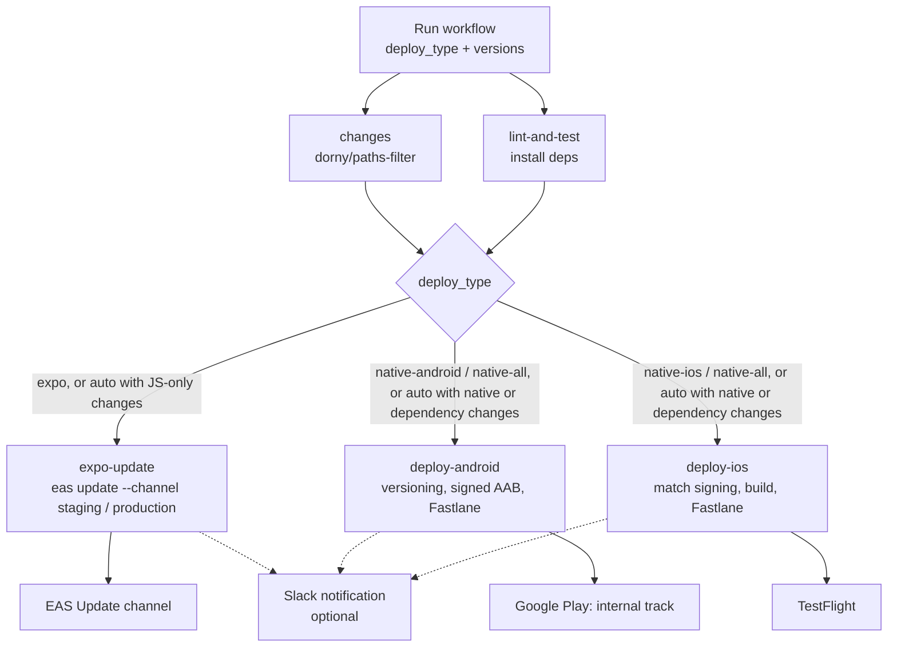

# React Native Release Pipeline: OTA + Native Builds

[](https://github.com/AttayR/CI-CD/actions/workflows/main.yml)
[](https://github.com/AttayR/CI-CD/actions/workflows/staging.yml)

A reference release pipeline for a React Native 0.77 app that uses Expo modules (`expo-updates`, `expo-dev-client`) on top of bare native projects. Shipping a mobile release usually means picking between a fast JavaScript-only update and a full store build, then repeating the same signing, versioning and upload steps by hand on two platforms. This project automates that choice. One GitHub Actions run looks at what changed, then either publishes an over-the-air update to an EAS Update channel, or builds signed Android and iOS binaries and uploads them to Google Play internal testing and TestFlight through Fastlane.

The app itself is a small Appwrite-backed login/signup demo. It exists to give the pipeline something real to ship.

---

## Contents

- [How a release works](#how-a-release-works)
- [Staging vs production](#staging-vs-production)
- [Environments and configuration](#environments-and-configuration)
- [Secrets](#secrets)
- [Tech stack](#tech-stack)
- [Project structure](#project-structure)
- [Getting started locally](#getting-started-locally)
- [Reusing the pipeline in another app](#reusing-the-pipeline-in-another-app)
- [Further documentation](#further-documentation)

---

## How a release works

Both workflows are started manually from the **Actions** tab (`workflow_dispatch`). You pick the branch to run against and a deployment type. Nothing deploys on a plain `git push`.

| Workflow | File | OTA channel | Android lane | iOS lane |
| --- | --- | --- | --- | --- |
| Staging CI/CD | [`.github/workflows/staging.yml`](.github/workflows/staging.yml) | `staging` | `fastlane staging` | `fastlane staging` |
| Production CI/CD | [`.github/workflows/main.yml`](.github/workflows/main.yml) | `production` | `fastlane playstore` | `fastlane staging` |

### Run inputs

| Input | Values | Purpose |
| --- | --- | --- |
| `deploy_type` | `auto` (default), `expo`, `native-android`, `native-ios`, `native-all` | Which deployment to run |
| `version_code` | optional, e.g. `8` | Android `versionCode`. Empty means current + 1 |
| `version_name` | optional, e.g. `1.0.7` | Android `versionName`. Empty means bump the patch number |
| `ios_version` | optional, e.g. `1.2.0` | iOS marketing version, set with `agvtool`. Empty means no change |
| `ios_build_number` | optional, e.g. `45` | iOS build number, set with `agvtool`. Empty leaves it to the Fastlane lane, which increments it |

### Pipeline flow



### Jobs

| Job | Runner | What it does |
| --- | --- | --- |
| `changes` | ubuntu | Classifies changed files into `native`, `deps` and `js` groups (see below). |
| `lint-and-test` | ubuntu | Sets up Node 20, restores the `node_modules` cache, installs dependencies. Every deploy job depends on it. |
| `expo-update` | ubuntu | Installs dependencies, sets up `expo/expo-github-action@v8` with `EXPO_TOKEN`, and runs `eas update --non-interactive --channel <channel>` with the short commit SHA as the message. |
| `deploy-android` | ubuntu | JDK 17, Node 20, Android SDK. Decodes the release keystore from a secret, updates `versionCode` / `versionName` in `android/app/build.gradle`, runs `./gradlew bundleRelease` with signing properties, then uploads the AAB with Fastlane. |
| `deploy-ios` | macOS, 60 min timeout | Node 20, Ruby 3.2, Fastlane and CocoaPods, `pod install`. Writes the App Store Connect API key, optionally sets version and build number, then runs `fastlane staging`. |

### Change detection (`auto` mode)

| Group | Paths | Result in `auto` mode |
| --- | --- | --- |
| `native` | `android/**`, `ios/**` | Native build on both platforms |
| `deps` | `package.json`, lockfiles, `app.json`, `babel.config.js`, `metro.config.js`, `tsconfig.json` | Native build on both platforms |
| `js` | `src/**`, `assets/**`, `index.js`, `**/*.{js,jsx,ts,tsx}` | OTA update, but only when there are no `native` or `deps` changes |

Dependency and config changes go down the native path on purpose. A new package or an `app.json` change can alter the native runtime, so it should never ship over the air.

### Fastlane lanes

**Android** ([`android/fastlane/Fastfile`](android/fastlane/Fastfile)). CI builds the AAB first. The lanes only upload it.

| Lane | Used by | Action |
| --- | --- | --- |
| `staging` | staging workflow | `upload_to_play_store` to the `internal` track, release status `completed` |
| `playstore` | production workflow | `upload_to_play_store` to the `internal` track, release status `completed` |
| `deploy` | not used in CI | `gradle clean assembleRelease` + `upload_to_play_store` |

**iOS** ([`ios/fastlane/Fastfile`](ios/fastlane/Fastfile))

| Lane | Used by | Action |
| --- | --- | --- |
| `staging` | both workflows | `match` (appstore), switch to manual signing, increment build number, `build_app`, `upload_to_testflight` (internal only, no wait for processing) |
| `production` | not used in CI | Same build, then `upload_to_app_store` without metadata or screenshots. Not submitted for review, no automatic release |
| `tests` | not used in CI | `scan` on the `appwriteAuth` scheme |
| `sync_certificates` | local | `match` for appstore and development profiles |

In CI, a `before_all` hook loads the App Store Connect API key and creates a temporary unlocked keychain. `after_all` and `error` hooks delete it. This was added to stop CI builds from freezing at the "Embed Pods Frameworks" build phase.

---

## Staging vs production

The two workflow files run the same jobs. They differ only in these places:

| | Staging (`staging.yml`) | Production (`main.yml`) |
| --- | --- | --- |
| EAS Update channel | `staging` | `production` |
| Android lane | `staging` | `playstore` |
| AAB kept as a workflow artifact | Yes, `android-aab-staging-<sha>` | No |
| Play Store destination | Internal track | Internal track |
| iOS destination | TestFlight | TestFlight |
| CocoaPods | `pod install --repo-update` | `pod install`, with `COCOAPODS_PARALLEL_CODE_SIGN=false` |

Both native paths stop at internal testing. Promotion to a public track or App Store review stays a manual step.

---

## Environments and configuration

| Layer | Where | What it controls |
| --- | --- | --- |
| EAS Update channels | `staging.yml`, `main.yml`, `eas.json` | Which installed builds receive an OTA update |
| EAS build profiles | [`eas.json`](eas.json) | `development` (dev client, internal), `preview` (internal), `staging` (internal, auto-increment), `production` (auto-increment). Each profile maps to the channel of the same name. `appVersionSource` is `remote`. |
| OTA runtime | [`app.json`](app.json) | `updates.url`, `checkAutomatically: ON_LOAD`, `fallbackToCacheTimeout: 0`, and `runtimeVersion`. Only builds with a matching `runtimeVersion` accept an update. |
| App config | `.env` via `react-native-config` | `APPWRITE_ENDPOINT` and `APPWRITE_PROJECT_ID`, read in `src/appwrite/service.ts`. Android loads it through `dotenv.gradle`. |

To check what runtime a given install expects, look at `runtimeVersion` in `app.json` at the commit it was built from. Bump it whenever native code changes, so old binaries do not receive incompatible JavaScript.

The workflows do not generate a `.env` file. Provide one before a native build if the app needs real Appwrite values.

---

## Secrets

Add these under **Settings → Secrets and variables → Actions**. Only the names are listed here.

| Secret | Used by | Purpose |
| --- | --- | --- |
| `EXPO_TOKEN` | `expo-update` | Expo / EAS authentication |
| `EAS_PROJECT_ID` | `expo-update` | Exported to the update step. The project ID is also set in `app.json`. |
| `KEYSTORE_BASE64` | `deploy-android` | Base64-encoded release keystore, decoded to `android/app/keystore.jks` |
| `KEYSTORE_KEY_ALIAS` | `deploy-android` | Release key alias |
| `KEYSTORE_STORE_PASSWORD` | `deploy-android` | Keystore password |
| `KEYSTORE_KEY_PASSWORD` | `deploy-android` | Key password |
| `GOOGLE_PLAY_SERVICE_ACCOUNT_JSON` | `deploy-android` | Play Console service account. Written to `playstore-credentials.json` for Fastlane, then deleted. |
| `APP_STORE_CONNECT_API_KEY_ID` | `deploy-ios` | App Store Connect API key ID |
| `APP_STORE_CONNECT_ISSUER_ID` | `deploy-ios` | App Store Connect issuer ID |
| `APP_STORE_CONNECT_API_KEY_CONTENT` | `deploy-ios` | Contents of the `.p8` key |
| `MATCH_PASSWORD` | `deploy-ios` | Decrypts the `match` certificates repo |
| `MATCH_GIT_BASIC_AUTHORIZATION` | `deploy-ios` | Git access to the `match` certificates repo |
| `SLACK_WEBHOOK` | all jobs | Optional. Jobs post their status to Slack only when it is set. |

To produce `KEYSTORE_BASE64` from a local keystore at `android/app/keystore.jks`:

```bash
./scripts/encode-keystore.sh
```

`.gitignore` excludes `*.jks`, `*.keystore` (except the debug keystore) and `*credentials.json`.

---

## Tech stack

| Area | Tools |
| --- | --- |
| App | React Native 0.77, React 18.3, TypeScript 5.0 |
| Expo modules | Expo SDK 52, `expo-updates`, `expo-dev-client` |
| Navigation | React Navigation 7 (native stack) |
| Backend | Appwrite (`appwrite` SDK 17) |
| Config | `react-native-config` |
| CI | GitHub Actions, `dorny/paths-filter`, `expo/expo-github-action` |
| OTA delivery | EAS Update |
| Native release | Fastlane (`supply`, `match`, `gym`, `pilot`), Gradle, CocoaPods |
| Notifications | Slack incoming webhook |
| Quality | ESLint, Prettier, Jest |

---

## Project structure

```
.
├── .github/workflows/
│   ├── main.yml            # Production CI/CD
│   └── staging.yml         # Staging CI/CD
├── android/
│   ├── app/build.gradle    # versionCode/versionName, release signing from -P properties
│   └── fastlane/           # Appfile, Fastfile (staging, playstore, deploy), Play metadata
├── ios/
│   ├── Podfile
│   └── fastlane/           # Appfile, Fastfile (staging, production, tests, sync_certificates), Matchfile
├── scripts/
│   └── encode-keystore.sh  # Base64-encodes the release keystore for GitHub Secrets
├── src/
│   ├── App.tsx
│   ├── appwrite/           # Appwrite client service and auth context
│   ├── components/
│   ├── routes/             # Auth stack, app stack, router
│   └── screens/            # Login, Signup, Home
├── app.json                # Expo config: updates URL, runtimeVersion, identifiers
├── eas.json                # EAS build profiles and channels
└── index.js                # Registers the "main" component
```

---

## Getting started locally

### Prerequisites

- Node.js 18 or newer (CI uses Node 20)
- Yarn
- JDK 17 and the Android SDK for Android builds
- Xcode, Ruby and CocoaPods for iOS builds
- Fastlane, if you want to run lanes locally

### Setup

```bash
git clone https://github.com/AttayR/CI-CD.git
cd CI-CD
yarn install
cd ios && pod install && cd ..
```

Create a `.env` file in the project root with your own Appwrite values:

```bash
APPWRITE_ENDPOINT=
APPWRITE_PROJECT_ID=
```

### Scripts

| Command | Runs | What it does |
| --- | --- | --- |
| `yarn start` | `react-native start` | Starts the Metro bundler |
| `yarn android` | `expo run:android` | Builds and runs the Android app |
| `yarn ios` | `expo run:ios` | Builds and runs the iOS app |
| `yarn lint` | `eslint .` | Lints the project |
| `yarn test` | `jest` | Runs Jest tests |
| `./scripts/encode-keystore.sh` | shell | Prints the release keystore as base64 for `KEYSTORE_BASE64` |

### Running lanes and updates by hand

```bash
# Android: upload an AAB that is already built
cd android && fastlane staging

# iOS: build and upload to TestFlight
cd ios && fastlane staging

# iOS: sync signing certificates and profiles
cd ios && fastlane sync_certificates

# OTA update to a channel
npx eas-cli update --channel staging --message "Describe the change"
```

The Android lanes expect `playstore-credentials.json` in `android/` and an AAB at `android/app/build/outputs/bundle/release/app-release.aab`.

---

## Reusing the pipeline in another app

The workflows are app-agnostic. Most of the work is replacing identifiers.

1. **Copy the files.** Take `.github/workflows/`, `android/fastlane/`, `ios/fastlane/`, `scripts/encode-keystore.sh` and `eas.json`.
2. **Point Expo at your project.** In `app.json`, set `updates.url`, `extra.eas.projectId`, `owner` and `runtimeVersion`. Add `expo-updates` to the app if it is not there already.
3. **Android signing.** Make `android/app/build.gradle` read `MYAPP_RELEASE_STORE_FILE`, `MYAPP_RELEASE_KEY_ALIAS`, `MYAPP_RELEASE_STORE_PASSWORD` and `MYAPP_RELEASE_KEY_PASSWORD` in its release `signingConfig`. Set `package_name` in `android/fastlane/Appfile`.
4. **iOS signing.** Update `ios/fastlane/Appfile` and `Matchfile` (bundle ID, team ID, certificates repo). In `ios/fastlane/Fastfile`, update `team_id`, the `match` profile name, the Xcode project path, the workspace and the scheme.
5. **Secrets.** Add every secret from the [Secrets](#secrets) table to the new repository.
6. **Channels.** Keep `staging` / `production` or rename them. Workflow channel names must match the channels in `eas.json`.
7. **Change filters.** Adjust the `native`, `deps` and `js` path lists in the `changes` job to match your folder layout.

---

## Further documentation

| Document | Covers |
| --- | --- |
| [CI_CD_GUIDE.md](CI_CD_GUIDE.md) | Full walkthrough: deployment types, triggering runs, versioning, iOS `match` and signing, Android keystore setup |
| [CI_CD_EXPO_UPDATE_REPORT.md](CI_CD_EXPO_UPDATE_REPORT.md) | Implementation report for the OTA + native split, with problems hit and how they were solved |
| [CI_CD_DOCUMENTATION.md](CI_CD_DOCUMENTATION.md) | Original Android-focused pipeline docs: version management, keystore setup, troubleshooting |
| [android/fastlane/README.md](android/fastlane/README.md) | Generated Fastlane lane reference for Android |

---

## License

[MIT](LICENSE) © 2025 Attay Rasool
